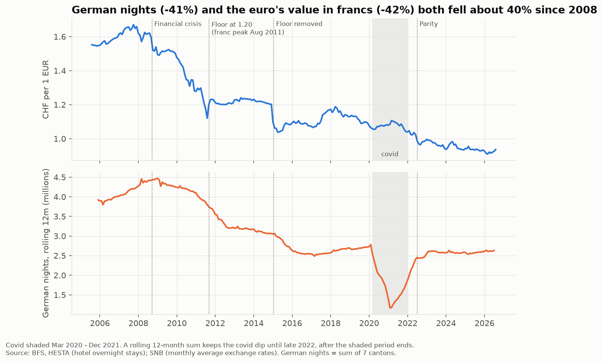
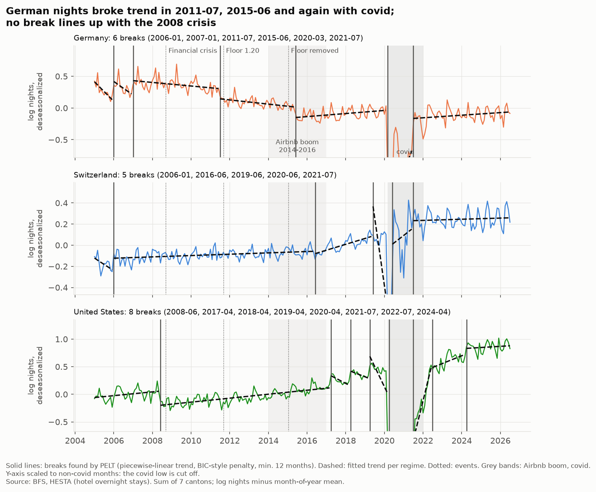
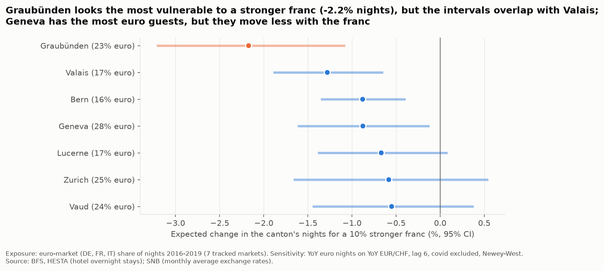

# The Strong Franc and Swiss Tourism

**Forecasts monthly hotel overnight stays by canton, origin market and resort type (luxury vs mid-range) 1 to 12 months ahead, so hotels can plan seasonal pricing and seasonal staffing, and quantifies how much the Swiss franc moves that forecast.**

[Dashboard: link to be added]

## Key findings
- **German demand stepped down twice, and has not come back.** Change-point detection finds two downward steps in German hotel nights: Jul 2011 (-15.0%) and Jun 2015 (-15.3%), around the franc surge and the end of the EUR/CHF floor. No break lines up with the 2008 crisis. In mid-2026, German nights are still about 14% below 2014.
- **Losses are fast, recovery is slow (hysteresis).** When the franc weakened again in 2016-2018, EUR/CHF recovered 52% of its 2014-2016 fall, but German nights recovered only 30% of theirs.
- **Exposure is not vulnerability.** Geneva has the largest share of euro guests (27.6%), but its nights move little with the rate, so it ranks 4th. Graubünden looks the most vulnerable: -2.2% nights for a 10% stronger franc (95% CI -3.2% to -1.1%). Its interval overlaps Valais (-1.3%), so the ranking is not clearly separated.
- **The franc improves forecasts during shocks, not in calm periods.** In the 2015-16 shock, the model with FX had 7.6% error (WAPE) vs 8.0% without FX, a gain larger than all 20 time-shifted FX placebos. After covid the gain is inconclusive (p = 0.095), and in 2011-12 there is none.
- **Recommendation: at 6-12 months, average the model with "same month last year".** The combination has 8.3% error at 6 months and 8.4% at 7-12 months, vs 8.7% for "same month last year". The model alone does worse than the naive at 12 months (10.4%).





## Method
1. **Data:** BFS HESTA monthly hotel nights, 7 cantons × 7 origin markets (2005-2026) and 8 paired resorts (2013-2026), plus SNB monthly exchange rates.
2. **SQL layer:** DuckDB views for year-over-year change, market share, seasonal profiles and canton segments; the same tables are exported to BigQuery for the dashboard.
3. **Change points:** PELT (`ruptures`) on German, Swiss and US nights, with covid excluded from the FX estimates; FX lags and asymmetry tested with HAC regressions.
4. **Forecasting:** a global gradient-boosting model per horizon (direct strategy, FX lagged ≥ h), against a seasonal-naive baseline, with rolling-origin validation (no random splits), 20 time-shifted FX placebos and Diebold-Mariano tests.
5. **Pre-registered rules:** test windows, thresholds and the analyst's predictions were committed before the results; decisions taken after seeing results are labelled as such.

## Limitations
- **Hotels only.** HESTA does not cover holiday flats or Airbnb, so a shift of guests to them looks like lost demand.
- **Associations, not causation.** FX effects are measured as links, not causal effects; the 2015 shock overlaps the Airbnb boom.
- **Scuol merger.** Scuol merged with five villages on 1 Jan 2015, so the St. Moritz - Scuol pair cannot be compared across 2015 (found after the results; the luxury-vs-mid-range claim is not established).
- **scikit-learn instead of LightGBM.** Results use `HistGradientBoostingRegressor`, because LightGBM could not be installed on the development machine; the backend is a parameter in `src/forecast.py`.

Built with Claude Code as a pair programmer; I defined the questions, scope and methodology and reviewed every PR.

## Reproduce
```bash
pip install -r requirements.txt
python src/load_data.py
python src/build_db.py
python src/run_experiments.py --jobs 4   # ~1 h 45 min, cached for notebooks 04-05
python src/run_long_horizon.py --jobs 4  # h = 7-12 backtest, ~5 min, cached for notebook 05
python src/export_bq.py --dry-run         # dashboard tables; drop --dry-run to upload to BigQuery
jupyter nbconvert --to notebook --execute --inplace --ExecutePreprocessor.timeout=-1 \
  notebooks/01_eda.ipynb notebooks/02_fx_effect.ipynb notebooks/03_forecasting.ipynb \
  notebooks/04_forecast_experiments.ipynb notebooks/05_long_horizon.ipynb notebooks/06_original_questions.ipynb
```

## Updating with new BFS data
BFS publishes HESTA monthly, about 5-6 weeks after the end of the month.
1. **Download** from the BFS PxWeb tables, same selections and format as the current files (CSV, semicolon, see `data/README.md`):
   `px-x-1003020000_102` (canton, overnight stays, 7 cantons x 7 countries) and `px-x-1003020000_101` (commune, arrivals and overnight stays, the 8 resorts);
   optionally the SNB cube `devkum` for newer exchange rates.
2. **Save under a new file name** in `data/raw/` (e.g. `bfs_hesta_canton_monthly_2005_2026-08.csv`); never overwrite a raw file.
   Point the file names in `src/load_data.py` to the new files and add a row to the table in `data/README.md`.
3. **Move the forecast origin** to the new last month with data for all 57 series: `OUTLOOK_ORIGIN` in `src/long_horizon.py`
   (and, to extend the test period, `TEST_END` in `src/forecast.py`).
4. **Re-run the pipeline** with the commands above, in order. New data change the cache fingerprints, so `run_experiments.py`
   and `run_long_horizon.py` must run again before notebooks 04-05; then `python src/export_bq.py` to refresh the dashboard.

More detail: [`data/README.md`](data/README.md) (sources, data quirks) and [`ROADMAP.md`](ROADMAP.md) (sprints).
